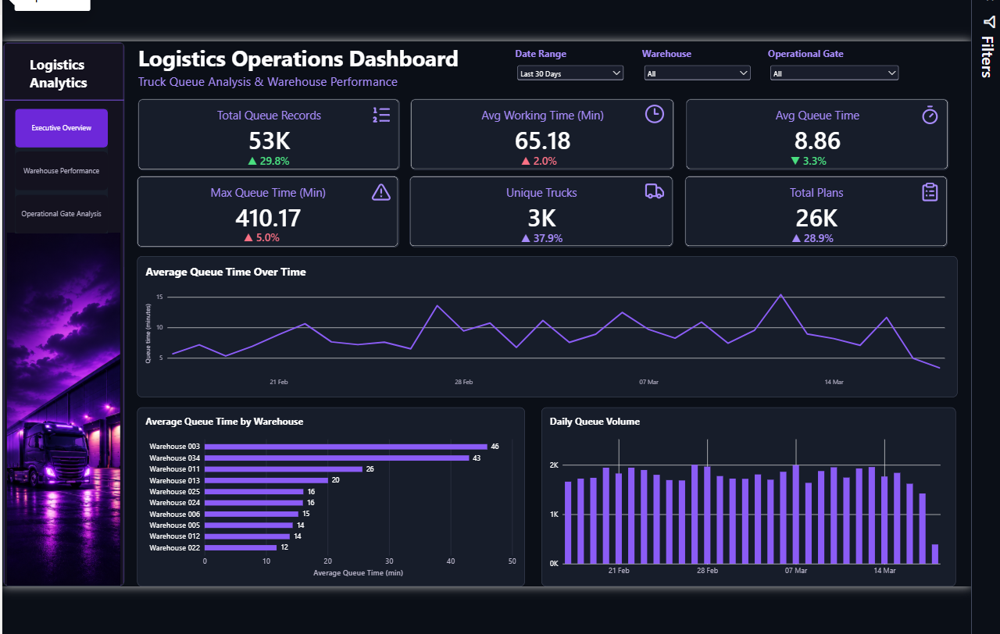
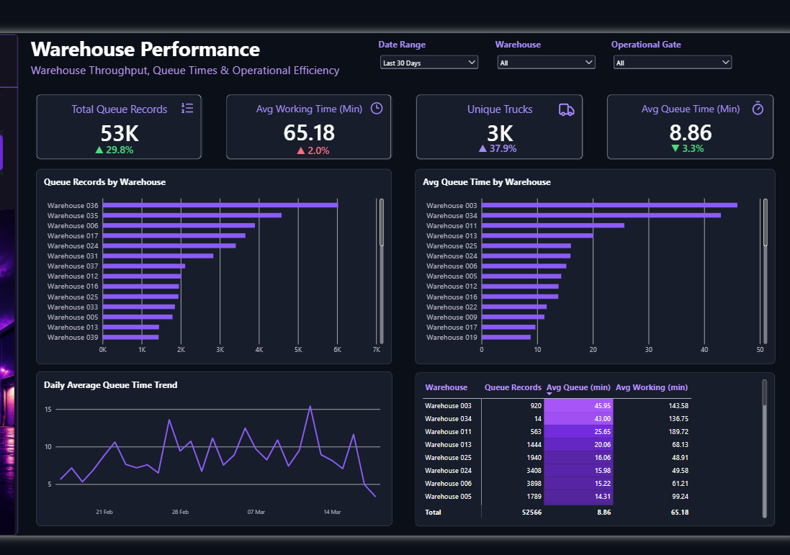
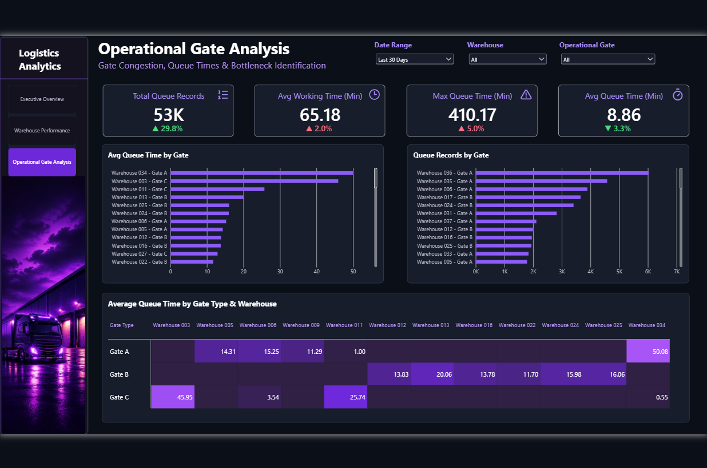

# Logistics Operations Analytics | SQL & Power BI

**An end-to-end logistics analytics portfolio project focused on truck queues, warehouse performance, and operational gate bottlenecks.**

This project explores how recorded queue activity, waiting time, and working time vary across warehouses and operational gates. It combines data validation and analysis in **SQL** with a three-page interactive **Power BI** report using **Power Query** and **DAX**.

> **Portfolio privacy note:** Warehouse and gate labels shown in the report are pseudonyms. The source data and original PBIX are intentionally not included in this public repository because original identifiers remain in the underlying model. A sanitized PBIX may be provided in a future release. The screenshots represent a report built from a third-party logistics dataset, not a live production system.

## Dashboard preview

### 1. Executive Overview


A high-level view of queue records, working and waiting times, unique trucks, plans, daily queue volume, and changes relative to the immediately preceding period of equal length.

### 2. Warehouse Performance


Compares warehouse queue-record volume, average queue and working times, and daily trends. A ranked table helps identify sites that warrant closer examination.

### 3. Operational Gate Analysis


Compares warehouse–gate combinations and highlights differences in average queue times using a gate-by-warehouse heatmap.

## Business questions

- Where are the longest observed truck queues?
- Which warehouse–gate combinations should be investigated first?
- Does higher queue-record volume necessarily coincide with longer waits?
- Which warehouses could be useful operational benchmark candidates?
- How should small samples and extreme waiting times affect prioritization?

## Tools and methods

| Tool | Application |
|---|---|
| SQL | Data exploration, consistency checks, validation, and preparation of analytical views |
| Power Query | Data shaping and supporting dimension preparation |
| Power BI | Three-page report, slicers, comparisons, matrix, heatmap, and custom KPI tooltip |
| DAX | Measures, selected-period versus previous-period comparisons, and display-label logic |

The report supports **Last 7 / 14 / 30 Days / All Data** selection, plus warehouse and operational gate filtering. DAX comparisons use the preceding period of equal length. Warehouse and gate identifiers remain internal model keys while the report presents pseudonymized labels.

## Key findings — selected 30-day view

**Network snapshot:** **52,566** queue records, **8.86 minutes** average queue time, and **65.18 minutes** average working time. Queue-record volume increased **29.8%**, while average queue time decreased **3.3%**, versus the preceding equal-length period.

### 1. Increased queue activity did not coincide with higher average waiting time
Queue-record volume increased by **29.8%** while average queue time fell **3.3%**. This is an encouraging descriptive trend, but it does not establish that operating efficiency improved or explain the change.

**Recommendation:** Monitor queue volume and waiting time together by warehouse, gate and day; investigate whether site mix, scheduling or operating conditions changed.

### 2. Warehouse 003 is a high-delay investigation candidate
**Warehouse 003 / Gate C** recorded **920** queue records, averaging **45.95 minutes** in queue—about **5.2×** the network average. Its average queue time nevertheless declined **33.6%** versus the preceding period.

**Recommendation:** Review arrival patterns, appointment scheduling and handling processes at this specific warehouse–gate combination before proposing changes.

### 3. High record volume does not automatically imply longer queues
**Warehouse 006** had **3,898** records and **15.22 minutes** average queue time, compared with Warehouse 003's **920** records and **45.95 minutes**. However, Warehouse 006's own average queue time increased **140.5%** from the previous period.

**Recommendation:** Compare similar workloads and monitor Warehouse 006's recent deterioration rather than treating its lower absolute queue time as sufficient evidence of good performance.

### 4. Extreme averages require sample-size context
**Warehouse 034** averaged **43.00 minutes** in queue but had only **14 records**. Gate A accounted for **12 records** at **50.08 minutes** average queue time; Gate C had **2 records** at **0.55 minutes**. Its maximum recorded queue time was **410.17 minutes**.

**Recommendation:** Audit the longest individual waits and data quality; use record counts and distributional metrics alongside averages before ranking low-volume sites.

### 5. Warehouse 036 is a potential benchmark
**Warehouse 036** handled **6,027** queue records—approximately **11.5%** of the network total—while averaging just **1.39 minutes** in queue, approximately **84% below** the network average. Its record volume rose **81.6%** while its average queue time fell **15.3%** versus the preceding period.

**Recommendation:** Examine its scheduling, gate usage, truck mix and working processes for transferable practices, controlling for differences in operating conditions.

## Suggested management priorities

1. **Investigate Warehouse 003 / Gate C** for sustained high queue times.
2. **Monitor Warehouse 006** for its sharp recent increase in average queue time.
3. **Benchmark Warehouse 036** against comparable sites before recommending process changes.
4. **Review Warehouses 013 and 011** for elevated average waiting times with meaningful record counts.
5. **Audit Warehouse 034 outliers**, treating its 14-record sample cautiously.

See [BUSINESS_INSIGHTS.md](BUSINESS_INSIGHTS.md) for the fuller evidence, limitations, and recommendations.

## Analytical approach

1. Explore and validate the source data with SQL, including warehouse and operational gate consistency.
2. Prepare analytical views and dimension tables for reporting.
3. Build Power BI relationships and reusable DAX measures for queue, working-time and volume KPIs.
4. Add period comparisons, slicers and a report-page tooltip explaining KPI change indicators.
5. Drill into warehouse and gate performance, cross-check findings against record counts, and document limitations.
6. Replace report-facing warehouse and gate labels with pseudonyms before capturing public screenshots.

## Interpretation and limitations

- **Queue records are not necessarily unique trucks, completed shipments, or physical throughput.**
- This is **descriptive observational analysis**; differences do not establish causality.
- Average queue time can obscure skewed distributions and extreme events; median and upper-percentile waits would strengthen future analysis.
- Warehouse operating conditions and truck mix may differ, limiting direct comparability.
- Prior-period percentage changes reflect the report's existing DAX logic and should be verified against source-period totals before operational use.
- Pseudonymizing visual labels does **not** anonymize the underlying PBIX; therefore the current PBIX and raw data are not distributed.

## Repository contents

```text
logistics-operations-portfolio/
├── README.md
├── BUSINESS_INSIGHTS.md
└── screenshots/
    ├── executive-overview.png
    ├── warehouse-performance.png
    └── operational-gate-analysis.png
```

**Planned extension:** Add reviewed, non-identifying examples of SQL validation and DAX measures, plus a separately sanitized PBIX when ready. No Python implementation is claimed for this project.
